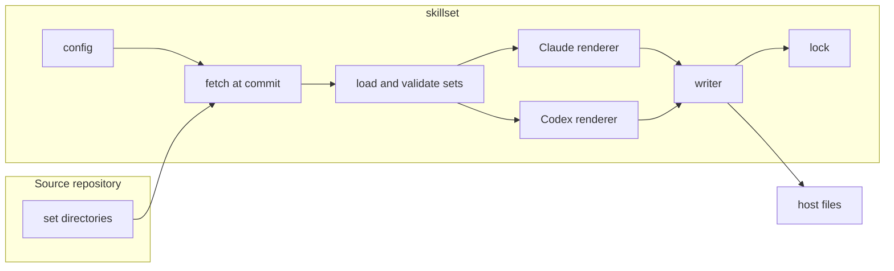

# RFC: Config and set formats

Status: Proposed

## Summary

skillset gets three formats. The **config** records what a user asked for: a source, a ref, the hosts and the sets. The **lock** records what skillset installed: the resolved commit, each set's version, and every file and entry it placed, with hashes. A **set** is one self-contained, versioned directory that describes skills, hooks, MCP servers, instructions, output styles and dcg packs once for every host. `skillset install` reads the config, fetches the source, renders each set into the plain files each host already reads, and writes the lock.

## Motivation

Today the config records only hosts and sets, a lock file pins a release tag that does not exist yet, and nothing records where an install came from. A set is a manifest that points into shared directories, can place arbitrary files in the home directory, and can rewrite the user's Claude settings through a three-way merge. Sets have no version, so an upgrade cannot say what changed.

All three formats are public contracts. Users keep the config and lock in their home directory or commit them to a repository, and third parties will write sets against the layout once skillset reads more than one source. Changing any of them after release breaks existing setups, so we settle them before the features that implement them.

## Scope

In scope: the config and lock at user and repo scope, the set layout and manifest, the version rule for sets, and how a set maps to each host's files.

The formats rest on these design choices, which the rest of this RFC assumes:

- `install` only writes files and never runs a host command, so it works without `claude` or `codex` on the PATH and behaves the same on both hosts.
- Skills are installed flat, with their set's name as a prefix (`/development-build` on Claude, `$development-build` on Codex), so skills from different sets cannot collide.
- Hooks and MCP servers become entries skillset owns inside each host's own files. skillset never rewrites the rest of those files.
- Instructions reach each host through one generated file and one line that points at it, so the user's own instructions file stays theirs.
- A config holds one source for now. The default source is the skillset repository's `main` branch, pinned to the commit it resolves to.

Out of scope: several sources in one config, set discovery, a Pi renderer, and the behaviour of `init`, `install`, `upgrade` and `doctor` beyond the formats they read and write.

Removed with no replacement:

- the base set's Claude settings, permission lists, sandbox config and statusline;
- the base set's Codex defaults (model, approval policy, sandbox mode);
- the personal set in `~/.config/skillset/local/`, which returns as a second source once a config can hold several.

## Proposed UX

### The config: what the user asked for

`skillset init` writes the config, and `install` changes it when the user picks different sets. At user scope it lives at `~/.config/skillset/config.toml`; at repo scope it is `skillset.toml` at the repository root, committed. skillset writes keys sorted and without timestamps, so two people changing it produce a small, mergeable diff. skillset rewrites the file, so comments are not kept.

```toml
# Managed by skillset. Change it with `skillset install`.
schema = 1
hosts = ["claude", "codex"]
sets = ["base", "development", "product"]

[[sources]]
name = "skillset"
url = "https://github.com/zenkoding/skillset"
ref = "main"      # a branch, tag or commit
```

`init` also accepts `owner/repo@ref` and expands it to a GitHub URL. A local directory source has `path` instead of `url` and `ref`. `sources` is a list from the start, so a second source later is not a format change; for now a config with more than one entry is an error. Set names resolve against the one source, and `sets` lists only what the user chose: sets they require are added at install time.

### The lock: what skillset installed

`install` and `upgrade` write the lock; nobody edits it by hand. At user scope it sits beside the config as `~/.config/skillset/skillset.lock.json`; at repo scope it is `.skillset.lock.json` at the repository root, committed with the files it describes, so a teammate's `doctor` and `uninstall` work on a fresh clone. Keys are sorted and there are no timestamps.

```json
{
  "schema": 1,
  "sources": {
    "skillset": { "commit": "829d5c8…" }
  },
  "sets": {
    "development": {
      "version": "1.0.0",
      "files": {
        "~/.agents/skills/development-build/SKILL.md": "sha256:…",
        "~/.local/share/skillset/development/hooks/guard.sh": "sha256:…"
      },
      "links": {
        "~/.claude/skills/development-build": "~/.agents/skills/development-build"
      },
      "entries": [
        { "file": "~/.claude/settings.json", "kind": "hook", "event": "PreToolUse", "command": "~/.local/share/skillset/development/hooks/guard.sh" },
        { "file": "~/.config/dcg/config.toml", "kind": "dcg-pack", "name": "kubernetes.kubectl" }
      ]
    }
  }
}
```

The shape above is illustrative; the fields it must carry are the resolved commit per source, the version per set, each placed file with its content hash, each link with its target, and each owned entry with enough detail to find and remove it. `upgrade` moves the commit; `install` with an unchanged config reproduces the same lock. A local directory source has no commit, so its lock entry records only set versions and hashes.

### A set

A set is one directory in the source repository, and everything it installs is inside it:

```
sets/development/
  set.toml
  instructions.md                 host-neutral instructions
  instructions.claude.md          optional, added on Claude only
  skills/
    development-build/SKILL.md
    development-tdd/
      SKILL.md
      references/planning-loop.md
  hooks/
    guard.sh
  dcg/
    kubectl-flag-bypass.yaml
  output-styles/                  Claude only
    dry.md
```

Skill directories, the `name` in each skill's frontmatter, and references from one skill to another all use the full prefixed name. What a reader sees in the repository is what installs; the renderer never rewrites skill text. The checks fail when a skill's name does not start with its set's name.

The manifest (field names provisional until implemented):

```toml
name = "development"
version = "1.0.0"
description = "Build loop: build, tdd, publish, review, address, test, codify"
requires = ["base"]

[[hooks]]
event = "PreToolUse"
matcher = "Bash|PowerShell|Monitor"
command = "hooks/guard.sh"   # relative to the set; installed with an absolute path

[mcp.docs]
command = "docs-mcp"
args = ["--stdio"]

[dcg]
enabled = ["kubernetes.kubectl", "platform.github"]
```

Validation rejects any file or manifest key outside this layout. `requires` names sets in the same source and carries no version range, because one source means the sets move together.

Hook events and tool matchers use Claude's names (`SessionStart`, `PreToolUse`, and the matcher `Bash|PowerShell|Monitor`), which Codex accepts unchanged. On Codex, a dcg hook needs a dcg release that emits Codex's three-field deny; with an older release, Codex ignores the deny and runs the command. MCP servers are installed under `<set>-<name>`, so two sets cannot collide and a reader can tell which set added an entry.

### Shared reference files

Several skills in different sets read the same reference files: the planning loop, the plan template, work sizing. These have one canonical copy in a shared directory of the source repository, outside any set. A build step copies each file into every skill that links it, the copies are committed, and the checks fail when a copy differs from its original. Installed sets stay self-contained, and an author edits the one canonical copy.

### What a user sees after install

On Claude at user scope, `/development-build` appears, the guard hook runs before shell commands, and the set's instructions load through one line skillset added to `~/.claude/CLAUDE.md`. On Codex, `$development-build` appears, and the hook runs once the user trusts it in `/hooks`. Removing a set from the config removes all of it, using the lock to find each file and entry.

## Proposed architecture

### Components



The loader turns set directories into one host-neutral model and rejects anything outside the layout. Each renderer turns that model into the files and entries one host reads, and lists what it skipped, such as an output style on Codex. The writer is the only part that touches the user's files: it adds and removes only what the lock says skillset owns, and writes the new lock last.

### Where rendered output goes

| Component | Claude, user scope | Codex, user scope | Repo scope |
| --- | --- | --- | --- |
| Skills | links in `~/.claude/skills/` to the copies in `~/.agents/skills/` | `~/.agents/skills/` | one copy in `.agents/skills/`, linked from `.claude/skills/` |
| Hooks | entries in `~/.claude/settings.json` | entries in `~/.codex/hooks.json` | entries in each host's repo hook file |
| MCP servers | entries in `~/.claude.json` | entries in `~/.codex/config.toml` | `.mcp.json`, `.codex/config.toml` |
| Instructions | import line in `~/.claude/CLAUDE.md` | reference line in `~/.codex/AGENTS.md` | line in `AGENTS.md` |
| dcg | entries in `~/.config/dcg/config.toml` | same file | `.dcg.toml` |
| Output styles | `~/.claude/output-styles/` | skipped | `.claude/output-styles/` |

Each skill has one copy at either scope, in the `.agents/skills/` directory that Codex reads. Claude Code does not read that directory, so skillset links each skill into Claude's skills directory; Claude Code follows a symlinked skill folder. The copy is written even when Claude is the only host, so the layout does not change when a user adds or drops a host.

Hook scripts and dcg packs need a fixed home that hook commands and dcg paths can point at. At user scope that is `~/.local/share/skillset/<set>/`; at repo scope it is the committed `.agents/skillset/<set>/`.

Instructions are merged, not kept per set: skillset writes one generated file per host, holding every installed set's instructions in dependency order, and the host's instructions file gets one line that points at it. At user scope the files are `~/.local/share/skillset/instructions.claude.md` and `instructions.codex.md`; at repo scope they sit in `.agents/skillset/`. Paths are provisional until implemented.

### Owned entries and drift

Every file skillset places and every entry it adds to a host file is in the lock with its hash or identity. That gives three rules:

- **Install and uninstall** touch only what the lock lists. A user's own hooks, MCP servers, dcg packs and instruction text stay as they are.
- **A user's edit** shows as a file whose hash no longer matches the lock. `install` stops and names it; `--force` replaces it. `uninstall` leaves it in place.
- **A lost entry**, for example an MCP server dropped when Claude rewrote `~/.claude.json`, shows as an owned entry the lock lists but the file lacks. `doctor` reports it and `install` adds it back.

At user scope the dcg config belongs to the user. skillset adds its pack names to `enabled` and its pack directory to `custom_paths`, and records each addition in the lock. A pack the user had already enabled is not recorded, so removing a set never removes it.

### Versions

Each set's manifest carries a semantic version: patch for wording, minor for a new skill, hook or MCP server, major for a removed or renamed one. The repository's checks compare every set directory with its merge base on `main` and fail when a file under a set changed and its version did not. No tag or stored hash is involved.

## Drawbacks

- A set's name is part of every skill name in it, so renaming a set renames its skills and breaks anyone who calls them by name.
- Shared reference files are committed several times. The checks keep the copies equal, but a diff that changes one shows every copy.
- The lock is a second committed file at repo scope, and two people installing different sets on different branches will conflict in it. Re-running `install` after the merge regenerates it.
- Editing the user's dcg config, Codex config and `~/.claude.json` means rewriting files we do not own. skillset must keep the user's other content, including comments in the TOML files, intact.
- A Claude-only install still places skills in `~/.agents/skills/`, where Codex and any other agent that reads that directory will find them.
- Codex has no import mechanism, so its instructions rely on the agent following a reference line.

## Rationale and alternatives

- **Config and lock, not one file.** One file would hold both requested and resolved state, but `upgrade` and every install would then rewrite the file people edit and review. Splitting them follows npm and Cargo: the config changes when a person changes their mind, the lock when skillset does work.
- **Hashes in the lock, not re-rendering.** skillset could rebuild what it installed from the recorded commit and compare, with no lock at all. That fails for a local directory source that has changed since, and needs the network for an uninstall.
- **Prefixed names in the source.** The renderer could add the prefix, but skills name each other in their text, and rewriting prose at install time would make the installed skill differ from what an author reviewed.
- **Copies of shared references.** Base could own the shared files and other sets link into it, but then no set outside base is self-contained, and a third-party set could not reuse them.
- **Harness plugins.** Claude and Codex both have plugin systems, but using them means running host commands during install and different namespacing per host. Plain files work the same on both.

## Prior art

`vercel-labs/skills` installs skills as plain files into the same host directories, records its sources in a lock file and tracks installed content by hash. It handles skills only. We take its plain-file layout, its `owner/repo@ref` shorthand, its lock with hashes, and its single committed copy at repo scope.

## Validation

To check once implemented:

- `install` with an unchanged config writes a byte-identical config and lock.
- A set with an unknown file or manifest key fails validation, and so does a skill without its set's prefix.
- Changing a set without a version bump fails the repository's checks, and so does a shared reference copy that differs from its original.
- Removing a set leaves the user's own hooks, MCP servers and dcg packs in place.
- A fresh home on each host shows the prefixed skills, the hook firing and the instructions loaded.

Not yet verified: that prefixed skills load on both hosts, that rendered hook entries fire, and that a Codex agent follows the instruction reference line.

## Unresolved questions

- **Comment-preserving edits.** skillset adds entries to TOML files the user owns: the dcg config and the Codex config. Whether it can do so without dropping the user's comments and key order, using the TOML library it uses today, is unknown. Settled by a test against a commented file in the first feature that edits each of them.

## Future possibilities

Several sources in one config, with set names qualified by source; set discovery across sources; version ranges on `requires` once sets come from different sources; a Pi renderer.

## Terminology

- **Set**: a named, versioned directory of skills, hooks, MCP servers, instructions, output styles and dcg packs, installed together.
- **Source**: a git repository or local directory that holds sets.
- **Config**: the file that records the user's requested source, hosts and sets.
- **Lock**: the file that records what skillset installed: the resolved commit, set versions, placed files and owned entries.
- **Renderer**: the part of skillset that turns a set into one host's files.
- **Owned entry**: a hook, MCP server, dcg pack or line that skillset added to a file it does not own, and may remove.
